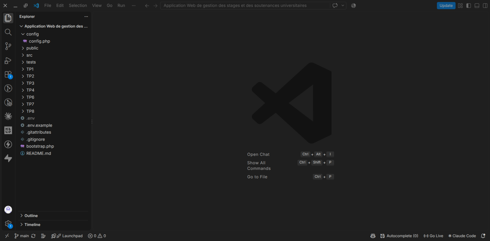

# TP4 — Vérification locale

## 0. Arborescence du dépôt

Capture de l'explorateur VS Code, prise sur la branche `main` le 20 novembre 2026 :



Les dossiers `TP1` à `TP8` contiennent les livrables documentaires, `public/` sert le frontend et
le point d'entrée HTTP, `src/` contient le backend PHP, `config/` lit les secrets dans `.env` et
`tests/` regroupe les scripts de vérification. `TP9` et `TP10` restent à produire.

## Prérequis

- PHP 8.1 ou plus ;
- extension `pdo_mysql` activée ;
- MySQL ou MariaDB ;
- `curl` pour les tests HTTP.

Vérifier PHP et l'extension :

```bash
php -v
php -m | grep -i pdo_mysql
```

Si `pdo_mysql` n'apparaît pas, installer le paquet correspondant à la version de PHP, par exemple :

```bash
sudo apt install php8.5-mysql
```

## 1. Configurer l'environnement

```bash
cp .env.example .env
```

Modifier `.env` avec les identifiants locaux. Exemple avec une base `stages` :

```dotenv
APP_ENV=local
APP_DEBUG=true

DB_HOST=127.0.0.1
DB_PORT=3306
DB_NAME=stages
DB_USER=root
DB_PASS=
```

Le fichier `.env` est ignoré par Git. Ne jamais le commiter.

## 2. Préparer la base (si nécessaire)

```bash
mariadb -u root -e "CREATE DATABASE stages CHARACTER SET utf8mb4 COLLATE utf8mb4_unicode_ci"
mariadb -u root stages < TP3/001_schema.sql
mariadb -u root stages < TP3/002_seed.sql
```

Pour l'application actuelle (TP6 à TP8), charger aussi les comptes et l'historique :

```bash
mariadb -u root stages < TP6/001_schema_tp6.sql
mariadb -u root stages < TP6/002_seed_tp6.sql
```

## 3. Tester la connexion PDO

```bash
php tests/test_connexion.php
```

Sortie attendue :

```text
[OK] Connexion PDO réussie à la base « stages » (127.0.0.1:3306).
```

## 4. Lancer le serveur

```bash
php -S 127.0.0.1:8000 -t public
```

Laisser ce terminal ouvert.

## 5. Tester la route de santé

Dans un second terminal :

```bash
curl -i http://127.0.0.1:8000/api/sante
```

Réponse attendue :

```http
HTTP/1.1 200 OK
Content-Type: application/json; charset=utf-8

{"statut":"ok","base":"ok"}
```

Ou avec le script fourni :

```bash
chmod +x tests/test_sante.sh
./tests/test_sante.sh
```

## 6. Vérifier les autres routes

```bash
curl -i http://127.0.0.1:8000/
curl -i http://127.0.0.1:8000/api/csrf
curl -i http://127.0.0.1:8000/api/demandes
curl -i -X POST http://127.0.0.1:8000/api/demandes
curl -i -X PATCH http://127.0.0.1:8000/api/demandes/2/statut
curl -i http://127.0.0.1:8000/api/inconnue
```

Résultats attendus avec l'application actuelle (TP8) :

| Requête | Code | Corps |
|---|---|---|
| `GET /` | `200` | interface HTML du TP7 |
| `GET /api/sante` | `200` | `{"statut":"ok","base":"ok"}` |
| `GET /api/csrf` | `200` | `{"csrf_token":"…"}` |
| `GET /api/demandes` | `401` sans session | `{"erreur":"Authentification requise."}` |
| `POST /api/demandes` | `401` sans session | `{"erreur":"Authentification requise."}` |
| `PATCH /api/demandes/2/statut` | `401` sans session | `{"erreur":"Authentification requise."}` |
| `GET /api/inconnue` | `404` | `{"erreur":"Route introuvable."}` |

Pour une écriture avec session, récupérer d'abord le jeton avec `GET /api/csrf`, puis l'envoyer
dans `X-CSRF-Token` ; sans jeton valide, la réponse est `403`. La connexion elle-même exige ce
jeton depuis le TP8. Les scripts `tests/test_api_tp6.sh` et `tests/test_api_tp8.sh` automatisent
ce parcours avec des cookies temporaires.

## 7. Tester le cas base indisponible

Arrêter MariaDB, puis relancer :

```bash
curl -i http://127.0.0.1:8000/api/sante
```

Réponse attendue : `503` avec `{"statut":"erreur","base":"indisponible"}`.

Le détail de l'erreur PDO doit apparaître dans le journal du serveur PHP, jamais dans la réponse HTTP.
